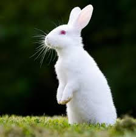
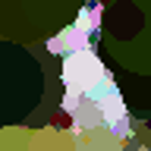
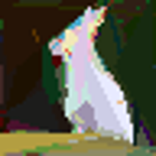
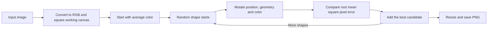
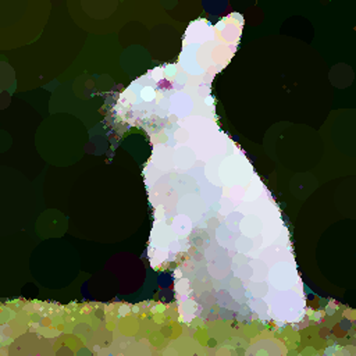
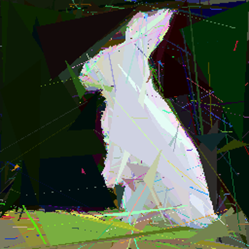

<div align="center">

# Abstracta2.0

**Rebuild an image from circles or triangles, one shape at a time.**

A small geometric-art experiment: propose a shape, improve its fit, add it to the canvas, repeat.

[](requirements.txt) [](main.py) [](LICENSE)

[**Generate an image**](#generate-your-first-image) · [**How it works**](#the-search-behind-the-shapes) · [**Options**](#choose-the-trade-off)

</div>

## What remains when a picture becomes primitives?

Abstracta2.0 approximates an input image with overlapping colored shapes. Instead of tracing outlines, it repeatedly searches for a shape that reduces pixel error. The result makes the process visible: circles emphasize patches of color; triangles create angular edges and facets.

| Input | Circles | Triangles |
| :---: | :---: | :---: |
|  |  |  |

*Actual outputs: 80 shapes, 48-pixel working canvas, 256-pixel output, seed 7. These are the quickstart settings below; a low working resolution deliberately shows a coarse approximation.*

| Choose a primitive | Watch the search | Repeat an experiment |
| --- | --- | --- |
| Circle or triangle canvases | Score/progress output and optional intermediate PNGs | Set a seed and keep the input, dependencies and parameters fixed |

## Generate your first image

Use Git and Python 3.10+ for the declared NumPy dependency. The commands are verified with Python 3.13. Everything runs locally with NumPy and Pillow; no model, API key or external service is needed.

```sh
git clone https://github.com/Muneer320/Abstracta2.0.git
cd Abstracta2.0
python -m pip install -r requirements.txt
python main.py -i src/rabbit.png -s circle -n 80 -w 48 -r 256 --seed 7 --no-progress --no-show
```

Open `output/final_circles.png`. To produce the triangle example:

```sh
python main.py -i src/rabbit.png -s triangle -n 80 -w 48 -r 256 --seed 7 --no-progress --no-show
```

The second run writes `output/final_triangles.png`. `--no-show` keeps the tool usable in a terminal/headless environment. Without it, Pillow opens the final result in the system image viewer. Existing final files for the same shape are overwritten.

## The search behind the shapes



Each shape uses 20 random starts and 50 mutation steps per start. The implementation redraws candidate canvases and compares them with the target using NumPy. It is a local hill-climbing approximation, not a guarantee of the globally best arrangement.

## Choose the trade-off

| Option | Default | Effect |
| --- | --- | --- |
| `-i`, `--image` | Required | Input image path |
| `-s`, `--shape` | `circle` | `circle` or `triangle` |
| `-n`, `--number` | `1200` | Number of shapes |
| `-w`, `--working-res` | `256` | Square canvas used during search |
| `-r`, `--resolution` | `512` | Final square output size |
| `--seed` | Unset | Random seed for repeatable experiments |
| `--no-progress` | Progress PNGs enabled | Disable snapshots otherwise saved every 20 shapes |
| `--no-show` | Viewer opens | Save without opening the viewer |

`--no-keep-progress` is equivalent to `--no-progress`; `-k`/`--keep-progress` enables snapshots. Use `python main.py --help` for the current parser. More shapes or a larger working canvas cost more computation. Raising only the output resolution resizes the result; it does not add detail to the search. Inputs are resized to a square, so non-square images change aspect ratio.

<details>
<summary><strong>Explore the bundled higher-detail reference outputs</strong></summary>

| Circles | Triangles |
| :---: | :---: |
|  |  |

These outputs predate this quickstart. Their exact parameters and seed were not recorded, so they are reference images rather than reproducible benchmark results.

</details>

## Explore and contribute

The implementation and CLI live in [main.py](main.py); dependencies are in [requirements.txt](requirements.txt). The current verification uses both actual seeded CLI runs and checks the generated files. There is no dedicated test suite in this repository. For a change, include a small reproducible image/run, check `--help`, confirm invalid inputs fail clearly and review output/progress behavior. Report issues in [the tracker](https://github.com/Muneer320/Abstracta2.0/issues).

This version extends the original Abstracta idea by [datavorous](https://github.com/datavorous/) with multiple primitives, a CLI, progress controls and seeded runs. Credit for the original idea remains with datavorous. [MIT license](LICENSE).
